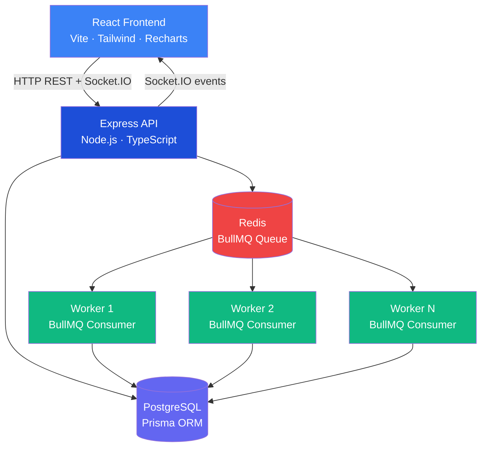

# Architecture

## System Overview



## Component Responsibilities

### React Frontend (`client/`)
- SPA served by nginx in Docker
- Authenticates with JWT stored in localStorage
- Connects to Socket.IO for real-time job status updates
- Falls back to 15-second polling when WebSocket is unavailable
- Pages: Login, Register, Dashboard, Jobs, Create Job, Job Detail, Workers, Profile

### Express API (`server/`)
- Stateless REST API — no session state
- Validates all inputs with Zod before they reach the database
- Creates jobs in PostgreSQL then enqueues them in Redis/BullMQ
- Emits Socket.IO events when job state changes (via worker-triggered DB updates)
- Enforces JWT authentication and role-based authorization

### Worker Service (`worker/`)
- Completely independent process — not imported by the API
- Connects directly to both Redis (BullMQ consumer) and PostgreSQL (Prisma)
- Registers itself in the `workers` table on startup with `upsert`
- Sends a heartbeat every 10 seconds to update `lastHeartbeat`
- Processes jobs using the processor registry (only safe, predefined handlers)
- On shutdown (SIGTERM): closes BullMQ worker gracefully, waits for in-flight jobs, marks itself OFFLINE

### PostgreSQL
- Durable storage for all job state, execution history, user data, worker registrations
- Source of truth — Redis queue is secondary
- All dashboard statistics are computed from PostgreSQL aggregations

### Redis
- BullMQ queue backend — stores pending, active, delayed, and completed job entries
- Priority queue: CRITICAL=1, HIGH=2, NORMAL=3, LOW=4 (lower number = higher priority)
- Delayed jobs stored with a delay offset — BullMQ moves them to `waiting` at the right time
- Does NOT store the canonical job state (that lives in PostgreSQL)

## Request Flow — Job Creation

```
POST /api/jobs
      │
      ├─► Zod validation (type, payload, priority, scheduledAt)
      │
      ├─► Idempotency check (if idempotencyKey provided)
      │
      ├─► prisma.job.create() → status=CREATED
      │
      ├─► bullmq.queue.add() → status=QUEUED (or SCHEDULED if delayed)
      │
      ├─► prisma.job.update(bullJobId) → save BullMQ job ID for cancellation
      │
      └─► 201 JSON response
```

## Request Flow — Job Processing (Worker)

```
BullMQ delivers job to Worker
      │
      ├─► prisma.job.update(status=RUNNING, startedAt=now, attempts+1)
      │
      ├─► prisma.jobExecution.create(status=RUNNING, workerId, attempt#)
      │
      ├─► registry.getProcessor(type) → dispatch to handler
      │
      ├─► On SUCCESS:
      │     ├─► prisma.jobExecution.update(COMPLETED, durationMs, result)
      │     ├─► prisma.job.update(COMPLETED, completedAt, result)
      │     └─► prisma.worker.update(ONLINE, jobsProcessed++)
      │
      └─► On FAILURE:
            ├─► prisma.jobExecution.update(FAILED, durationMs, errorMessage)
            ├─► prisma.worker.update(ONLINE, jobsFailed++)
            ├─► If attempts < maxAttempts:
            │     ├─► prisma.job.update(FAILED) temporarily
            │     └─► throw error → BullMQ retries with exponential backoff
            └─► If attempts >= maxAttempts:
                  ├─► prisma.job.update(FAILED permanently)
                  └─► throw UnrecoverableError → BullMQ stops retrying
```
