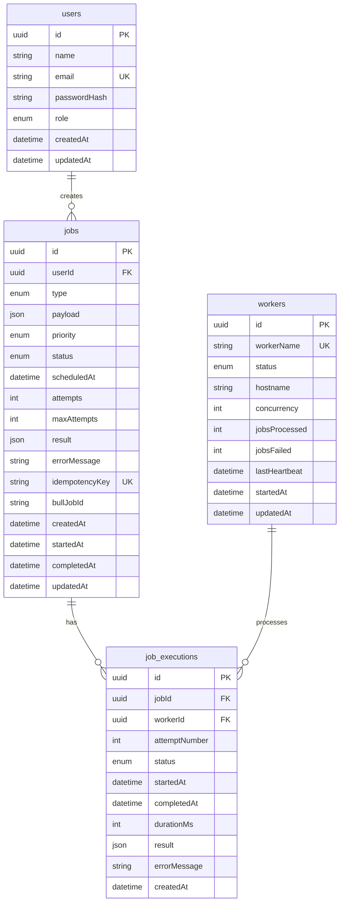

# Database Design

## ER Diagram



## Table Details

### users
| Column | Type | Notes |
|---|---|---|
| id | UUID | Generated by application (`uuid()`) |
| name | VARCHAR | Display name |
| email | VARCHAR | Unique — used as login identifier |
| passwordHash | VARCHAR | bcrypt hash, cost 12 — never returned in API responses |
| role | ENUM | `USER` or `ADMIN` |

### jobs
| Column | Type | Notes |
|---|---|---|
| id | UUID | Primary key |
| userId | UUID | FK → users (CASCADE delete) |
| type | ENUM | One of 5 predefined job types |
| payload | JSONB | Input data for the processor |
| priority | ENUM | `LOW\|NORMAL\|HIGH\|CRITICAL` |
| status | ENUM | Full lifecycle: CREATED→QUEUED→RUNNING→COMPLETED/FAILED/CANCELLED |
| scheduledAt | TIMESTAMP | UTC, nullable. Set for delayed jobs |
| attempts | INT | Incremented each time a worker picks up the job |
| maxAttempts | INT | Maximum retries (1–10) |
| result | JSONB | Processor output on success |
| errorMessage | TEXT | Last error message on failure |
| idempotencyKey | VARCHAR | Optional unique key for duplicate prevention |
| bullJobId | VARCHAR | BullMQ job ID — needed for queue removal on cancel |

### job_executions
One row per attempt. Enables full audit trail.

| Column | Type | Notes |
|---|---|---|
| jobId | UUID | FK → jobs (CASCADE delete — history deleted with job) |
| workerId | UUID | FK → workers (SET NULL — history preserved if worker deleted) |
| attemptNumber | INT | 1-indexed attempt count |
| status | ENUM | `RUNNING\|COMPLETED\|FAILED` |
| durationMs | INT | Null until execution completes |

### workers
Self-registered by each worker process on startup.

| Column | Type | Notes |
|---|---|---|
| workerName | VARCHAR | Unique — `worker-{instance}@{hostname}` |
| status | ENUM | `ONLINE\|BUSY\|OFFLINE` |
| lastHeartbeat | TIMESTAMP | Updated every 10s — stale if >30s ago |
| concurrency | INT | Max parallel jobs this worker handles |

## Indexes

```sql
-- jobs table
CREATE INDEX jobs_userId_idx     ON jobs(userId);
CREATE INDEX jobs_status_idx     ON jobs(status);
CREATE INDEX jobs_createdAt_idx  ON jobs(createdAt);
CREATE INDEX jobs_priority_idx   ON jobs(priority);
CREATE INDEX jobs_scheduledAt_idx ON jobs(scheduledAt);

-- job_executions table
CREATE INDEX job_exec_jobId_idx  ON job_executions(jobId);

-- workers table
CREATE INDEX workers_status_idx       ON workers(status);
CREATE INDEX workers_heartbeat_idx    ON workers(lastHeartbeat);
```

These indexes support the most common query patterns:
- Filter jobs by userId (ownership check)
- Filter/sort jobs by status, createdAt, priority
- Find scheduled jobs by scheduledAt
- Look up all executions for a job
- Find online workers (status + heartbeat freshness)

## Migrations

Prisma manages migrations. Each migration is stored in `prisma/migrations/` and committed to version control.

```bash
# Create a new migration (development)
npx prisma migrate dev --name describe_the_change

# Apply migrations (production / Docker)
npx prisma migrate deploy
```

## Seeding

`prisma/seed.ts` creates two demo users and 4 sample jobs:

| User | Email | Password | Role |
|---|---|---|---|
| Admin User | admin@jobqueue.dev | admin123 | ADMIN |
| Demo User | demo@jobqueue.dev | user1234 | USER |

Run with: `npx ts-node prisma/seed.ts`
