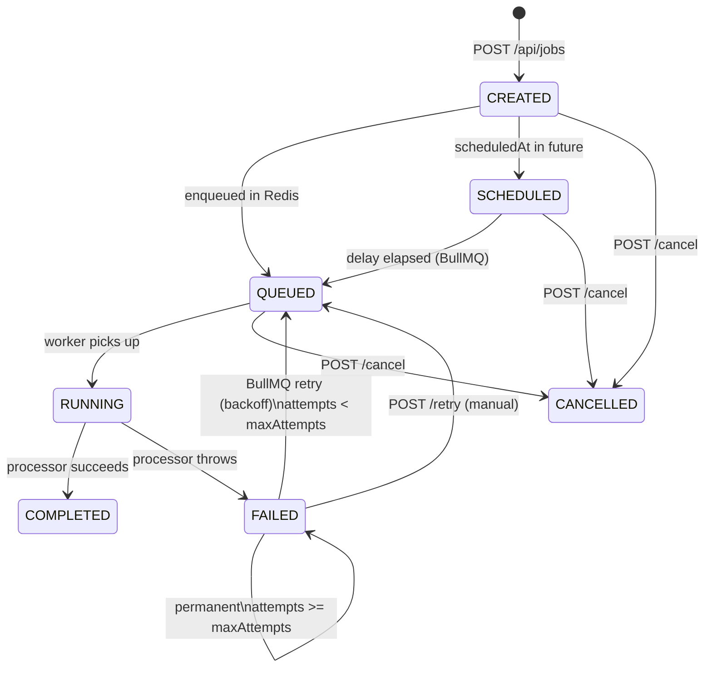

# Job Lifecycle

## State Diagram



## Status Descriptions

| Status | Description |
|---|---|
| `CREATED` | Job record created in PostgreSQL; about to be enqueued |
| `QUEUED` | Sitting in the Redis BullMQ queue, waiting for an available worker |
| `SCHEDULED` | Enqueued with a future delay; BullMQ will activate it at `scheduledAt` |
| `RUNNING` | A worker has picked it up and is actively executing the processor |
| `COMPLETED` | Processor returned successfully; result stored |
| `FAILED` | Processor threw an error; either retrying or permanently failed |
| `CANCELLED` | Manually cancelled by the user; removed from the Redis queue |

## Retry Policy

Each job has a `maxAttempts` field (default: 3, configurable 1–10).

BullMQ applies **exponential backoff**:

```
Attempt 1 fails → wait RETRY_BASE_DELAY_MS (default 2s)
Attempt 2 fails → wait 2 × base = 4s
Attempt 3 fails → wait 4 × base = 8s
...
Attempt N fails → wait 2^(N-1) × base
```

If the processor throws `UnrecoverableError`, BullMQ skips remaining retries immediately.

## Idempotency

Jobs can be created with an optional `idempotencyKey` (max 128 chars).

If a second request arrives with the same key, the original job is returned without creating a duplicate. This is enforced by a `UNIQUE` constraint on `jobs.idempotencyKey` at the database level, making it safe even under concurrent requests.

## Cancellation

Only jobs in `QUEUED`, `SCHEDULED`, or `CREATED` status can be cancelled.

On cancel:
1. The BullMQ job is removed from Redis (`queue.getJob(bullJobId).remove()`)
2. The PostgreSQL record is updated to `CANCELLED`

Running jobs cannot be interrupted safely in this implementation (documented limitation).

## Execution History

Every attempt is recorded in `job_executions`. This gives full observability:

```
Job #abc123 (maxAttempts=3)

Attempt 1  FAILED    1.2s   "Connection refused"
Attempt 2  FAILED    1.4s   "Connection refused"
Attempt 3  COMPLETED 1.1s   { sum: 55, average: 5.5, ... }
```
